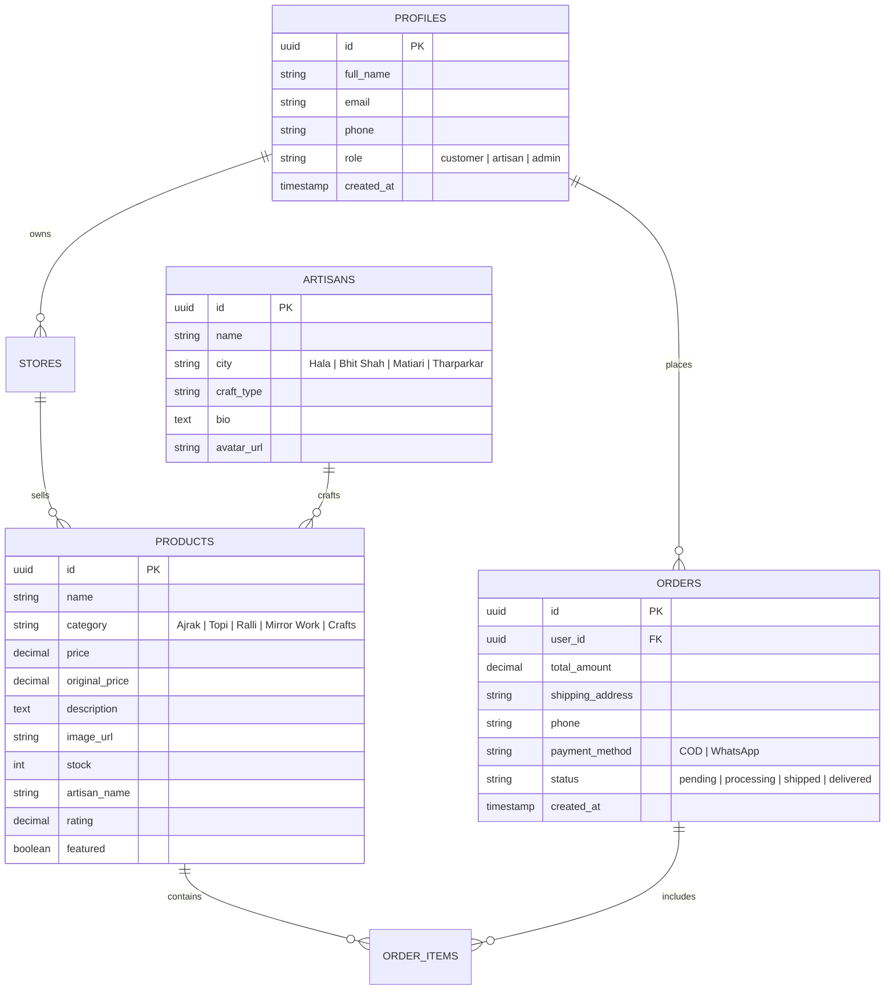

# SindhHunar (سنڌ ھنر) 🏺

> **Preserving Cultural Heritage & Empowering Artisans Through Modern Technology**  
> An authentic marketplace and digital museum connecting traditional Sindhi artisans directly with buyers worldwide.

[](https://reactnative.dev/)
[](https://nextjs.org/)
[](https://supabase.com/)
[](https://www.typescriptlang.org/)
[](https://tailwindcss.com/)
[](https://www.framer.com/motion/)

---

## 📖 Table of Contents

- [Overview & Vision](#-overview--vision)
- [Key Features](#-key-features)
- [Design Language & Brand Identity](#-design-language--brand-identity)
- [Tech Stack](#-tech-stack)
- [Project Architecture](#-project-architecture)
- [Database Schema (Supabase)](#-database-schema-supabase)
- [Getting Started](#-getting-started)
  - [Prerequisites](#prerequisites)
  - [Mobile App Setup (React Native)](#mobile-app-setup-react-native)
  - [Web Portal Setup (Next.js)](#web-portal-setup-nextjs)
- [Environment Variables](#-environment-variables)
- [Screenshots & UI Showcase](#-screenshots--ui-showcase)
- [Artisan Centers of Sindh](#-artisan-centers-of-sindh)
- [Contributing & License](#-contributing--license)

---

## 🌟 Overview & Vision

**SindhHunar (سنڌ ھنر)** is a dual-platform ecosystem (**Mobile App + Web Portal**) built to celebrate and preserve the millennia-old craftsmanship of the Indus Valley and Sindh.

### The Problem
Traditional artisans in rural centers like **Hala, Bhit Shah, Matiari, and Tharparkar** possess rare mastercraft skills (natural vegetable-dyed block printing, hand-stitched Ralli quilts, glazed Kashi ceramics, and hand-embroidered royal topis). However, they frequently face:
* Exploitation by middlemen who pocket up to 80% of retail margins.
* Lack of digital storefronts and payment gateways.
* Inadequate preservation of the cultural heritage behind each craft.

### The Solution
SindhHunar provides a direct-to-consumer bridge:
1. **Direct Marketplace:** Eliminates intermediaries so artisans receive fair value for their labor.
2. **Cultural Immersion:** Educates global buyers on the 5,000-year history and painstaking techniques behind each craft.
3. **Inclusive Accessibility:** Full trilingual support in **English**, **Sindhi (سنڌي)**, and **Urdu (اردو)** with automatic Right-to-Left (RTL) layout switching.

---

## ✨ Key Features

### 🛍️ 1. Cultural E-Commerce Bazaar
- **Categorized Discovery:** Instant filtering across authentic Sindhi categories:
  - **Ajrak (اجرک):** Natural indigo & madder block-printed textiles.
  - **Sindhi Topi (سنڌي ٽوپي):** Royal hand-embroidered caps with the signature crescent arch.
  - **Ralli Quilts (رلي):** Complex geometric patchwork and appliqué quilts.
  - **Mirror Work (شيشي جو ڪم):** Desert embroidery adorned with hand-cut mirror glass.
  - **Blue Pottery / Kashi (ڪاشي جو ڪم):** Glazed terracotta ceramics from Hala.
- **Dynamic Search & Filter:** Real-time search by product name, craft technique, or artisan name.
- **Product Detail Modal:** High-resolution zoom views, discount badges, artisan attribution, and stock status.

### 📜 2. Living Cultural Archives & Heritage Stories
- Interactive story cards depicting the history and folklore of Sindhi crafts:
  - *The 5,000-Year Legend of Ajrak* (dating back to the Indus Valley Priest-King).
  - *The Architecture of the Sindhi Topi* (representing dignity and the Islamic Mihrab).
  - *The Sacred Geometry of Ralli Quilts*.
- In-depth reader modal for culturally rich educational experiences.

### 🗺️ 3. Interactive Artisan Craft Map
- Geographic mapping of master artisans across Sindh's historical craft hubs:
  - **Hala:** Kashi (blue glazed pottery) & Lacquer woodwork (Jhandi).
  - **Bhit Shah:** Traditional handloom weaving (Khes & Susi).
  - **Matiari:** Authentic natural Ajrak block printing centers.
  - **Tharparkar & Umerkot:** Desert mirror work & Ralli patchwork quilts.
  - **Shikarpur & Sukkur:** Metal embossing and leather footwear.

### 🛒 4. "Jholi" (Cart) & Hybrid Checkout
- **Slide-out Cart Drawer:** Smooth quantity adjustment and subtotal calculations with free shipping incentives.
- **Cash on Delivery (COD):** Simple checkout form requiring no credit card barrier.
- **1-Tap WhatsApp Ordering:** Direct integration generating a formatted WhatsApp message with product details for fast fulfillment.
- **Celebration Feedback:** Interactive confetti cannon animation upon successful order placement.

### 🤖 5. Cultural AI Assistant
- An intelligent assistant embedded directly into the app that answers craft questions, authenticates manufacturing processes (e.g., natural dyes vs. chemical prints), and provides styling recommendations in English, Sindhi, and Urdu.

### 🌐 6. Native Trilingual & RTL Support
- Instant language switching between **English**, **Sindhi (سنڌي)**, and **Urdu (اردو)**.
- Automatic mirroring of layouts, typography, navigation bars, and drawers for natural RTL reading.

### 👥 7. Multi-Role Infrastructure
- **Buyers:** Explore, learn, add to cart, and track orders.
- **Artisans / Sellers:** Dedicated seller portal to list handcrafted inventory, set pricing, and manage incoming orders.
- **Admins:** Quality assurance verification, artisan onboarding, and catalog curation.

---

## 🎨 Design Language & Brand Identity

The visual identity is rooted in royal Sindhi architecture, desert landscapes, and traditional natural dyes:

| Token | Color Code | Cultural Significance |
| :--- | :--- | :--- |
| **Sindhi Maroon** | `#800000` | The rich madder dye (*Manjith*) of traditional Ajrak |
| **Antique Gold** | `#C5A059` | Royal zari embroidery, brass crafts, and desert sand |
| **Royal Indigo** | `#002366` | Natural indigo plant dye extracted along the Indus River |
| **Warm Desert Cream** | `#FAF9F6` | Raw unbleached handloom cotton and desert dunes |
| **Charcoal Dark** | `#1A1A1A` | Traditional iron-tannin black dye (*Syahi*) |

### Typography
- **Headings & Accents:** `Bebas Neue` — Bold, statuesque, and reminiscent of historic market banners.
- **Body & Interface:** `Poppins` — Clean, modern geometric sans-serif for effortless readability.
- **Sindhi & Urdu Script:** `Noto Nastaliq Urdu` — Elegant calligraphic Nastaliq rendering authentic regional text.

---

## 🛠️ Tech Stack

### Mobile Application
- **Framework:** React Native `0.84.0`
- **Navigation:** React Navigation `v7` (Bottom Tabs, Native Stack)
- **Animations:** React Native Reanimated `v4` & Lottie
- **State Management:** Redux Toolkit & React Query
- **Internationalization:** `i18next` & `react-i18next`
- **Maps:** `react-native-maps`
- **Hardware Integrations:** Vision Camera, Geolocation, Haptic Feedback

### Web Application
- **Framework:** Next.js `16.3` with Turbopack & React `19`
- **Styling:** Tailwind CSS `v4`
- **Animations:** Framer Motion
- **Icons:** Lucide React & Custom Cultural SVGs
- **Celebrations:** Canvas Confetti

### Cloud Backend & Services
- **Database:** Supabase (PostgreSQL with Row Level Security)
- **Storage:** Supabase Storage (Global CDN for high-res product photography)
- **Authentication:** Supabase Auth (Email/Password, JWT sessions)
- **Messaging:** Direct WhatsApp Business Click-to-Chat API

---

## 📁 Project Architecture

```text
SindhHunar/
├── android/                   # Android native configuration & Gradle scripts
├── ios/                       # iOS native workspace (if targeting iOS)
├── src/                       # Mobile Application Source Code
│   ├── assets/                # Local images (AjrakBG, logo, cardBg) & icons
│   ├── components/            # Reusable mobile UI components
│   ├── config/                # Environment configuration & constants
│   ├── context/               # Global state providers (Auth, Language, Cart)
│   ├── hooks/                 # Custom React hooks
│   ├── i18n/                  # Localization files (en.json, sd.json, ur.json)
│   ├── navigation/            # AppNavigator, TabNavigator, Seller/Admin Navigators
│   ├── screens/               # Screen Views
│   │   ├── admin/             # Admin management & verification
│   │   ├── auth/              # Login, Sign Up, & Password recovery
│   │   ├── chat/              # AI Assistant & artisan messaging
│   │   ├── culture/           # Cultural stories & heritage archives
│   │   ├── home/              # Main Bazaar & product catalog
│   │   ├── map/               # Geo-tagged artisan workshop map
│   │   ├── order/             # Jholi (Cart) & order history
│   │   ├── product/           # Product detail view & specs
│   │   ├── profile/           # User settings & language toggle
│   │   └── seller/            # Artisan seller onboarding & listing manager
│   ├── services/              # API, Supabase client, & WhatsApp services
│   ├── store/                 # Redux Toolkit / Zustand state stores
│   ├── types/                 # TypeScript interfaces & definitions
│   └── utils/                 # Haptics, formatting, & helper functions
│
└── web/ (or sindhhunar/)      # Next.js Web Companion Project
    ├── app/                   # App Router (page.tsx, layout.tsx, globals.css)
    ├── components/            # Web components (Hero, Navbar, CartDrawer, Stories)
    ├── context/               # Web AppContext (Supabase, Cart, Language state)
    ├── lib/                   # Supabase client & translations dictionary
    └── public/                # Static web assets & cultural images
```

---

## 🗄️ Database Schema (Supabase)

The database runs on hosted PostgreSQL with live realtime synchronization:



---

## 🚀 Getting Started

### Prerequisites
* **Node.js:** `v18.x` or `v20.x`
* **Package Manager:** `npm` or `yarn`
* **Android Development:** Android Studio, JDK 17, and Android SDK configured
* **Supabase Account:** Free project created on [supabase.com](https://supabase.com)

---

### Mobile App Setup (React Native)

1. **Clone the repository:**
   ```bash
   git clone https://github.com/your-username/SindhHunar.git
   cd SindhHunar
   ```

2. **Install dependencies:**
   ```bash
   npm install
   ```

3. **Configure Environment:**
   Create a `.env` file in the root directory:
   ```env
   SUPABASE_URL=https://your-project.supabase.co
   SUPABASE_ANON_KEY=your-publishable-key
   ```

4. **Start the Metro Bundler:**
   ```bash
   npm start
   ```

5. **Run on Android Device / Emulator:**
   ```bash
   npm run android
   ```

6. **Generate a Standalone APK for Testing:**
   ```bash
   cd android
   ./gradlew assembleRelease
   ```
   *The generated APK will be at `android/app/build/outputs/apk/release/app-release.apk`.*

---

### Web Portal Setup (Next.js)

1. **Navigate to the web project directory:**
   ```bash
   cd "../React/sindhhunar"
   ```

2. **Install web dependencies:**
   ```bash
   npm install
   ```

3. **Configure `.env.local`:**
   ```env
   NEXT_PUBLIC_SUPABASE_URL=https://your-project.supabase.co
   NEXT_PUBLIC_SUPABASE_ANON_KEY=your-publishable-key
   ```

4. **Run development server:**
   ```bash
   npm run dev
   ```
   *Open [http://localhost:3000](http://localhost:3000) in your browser.*

5. **Build for production:**
   ```bash
   npm run build
   npm run start
   ```

---

## 🔑 Environment Variables

| Variable Name | Environment | Purpose |
| :--- | :--- | :--- |
| `SUPABASE_URL` | Mobile (`.env`) | Supabase PostgreSQL API endpoint |
| `SUPABASE_ANON_KEY` | Mobile (`.env`) | Client-safe public Supabase anon key |
| `NEXT_PUBLIC_SUPABASE_URL` | Web (`.env.local`) | Public API endpoint for Next.js SSR & client |
| `NEXT_PUBLIC_SUPABASE_ANON_KEY` | Web (`.env.local`) | Client-safe public key for Next.js browser requests |

---

## 🗺️ Artisan Centers of Sindh

| Region | Primary Craft | Signature Materials |
| :--- | :--- | :--- |
| **Matiari & Bhit Shah** | Natural Ajrak block printing | Indigo, Madder root, Tamarind seed, River Indus water |
| **Hala** | Kashi blue ceramics & Jhandi lacquer | Clay, cobalt glaze, handcrafted sheesham wood |
| **Tharparkar & Umerkot** | Ralli quilts & Mirror embroidery | Vintage cotton remnants, cowrie shells, hand-cut glass |
| **Shikarpur** | Leather sandals (Zari Saleem Shahi) | Hand-tanned leather, gold thread, velvet inlay |

---

## 🤝 Contributing

Contributions to preserve cultural heritage are warmly welcomed!

1. Fork the Project
2. Create your Feature Branch (`git checkout -b feature/CulturalFeature`)
3. Commit your Changes (`git commit -m 'Add authentic craft story'`)
4. Push to the Branch (`git push origin feature/CulturalFeature`)
5. Open a Pull Request

---

## 📜 License

Distributed under the **MIT License**. See `LICENSE` for more information.

---

<div align="center">
  <sub>Made with dedication to the artisans, culture, and soil of Sindh. 🌾</sub><br/>
  <b>سنڌ سلامت، ساٿ سلامت</b>
</div>
